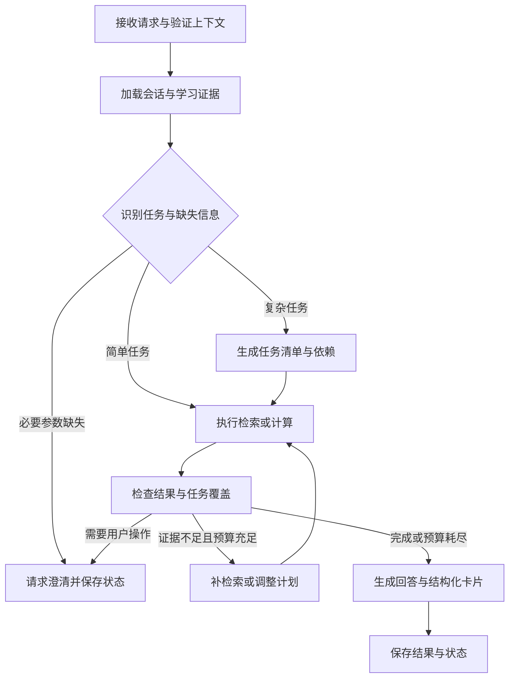

# V2 重构总设计：计算机网络智能学习工作台

日期：2026-10-15。状态：开发基线设计，尚未实现。分支：`v2`。旧版代码与历史保存在 `v1`；`v2` 为不继承旧提交历史的孤立分支。

本文是 V2 的产品与范围基线。基础设施方案已按“双数据库 + Redis + MinIO”重订，以 [01-架构设计说明书](./01-架构设计说明书.md) 为准。旧版 docs/01–10 在 `v1` 分支记录 V1，其中“零外部服务、前端免构建、单机演示优先”等限制不继承到 V2。当前分支先交付设计，旧入口在 `v1` 分支保留；后续按里程碑建立新代码，不将目录移动当成重构成果。

## 1. 产品目标与首个完整场景

定位：面向学习计算机网络的学生，提供有课程证据、有计算校验、能持续辅导的学习工作台。

核心链路：学习课程 → 向助教提问 → 做题 → 提交 → 获得评分与错因 → 复习关联知识 → 再次练习。

首个垂直场景选 IPv4 子网划分。种子内容包含一个经过人工核验的课程小节、至少 15 道题、知识点与先修关系、评分规则和代表性错因。用一个场景验证架构，再拓展路由与时延计算、TCP 等内容。

成功演示：用户向助教询问 /27 子网，追问“换成 /28 呢”，完成推荐练习，获得确定性计算校验和过程点评；错题关联到知识点及原文，复习后再次作答。系统能够解释每个结论与推荐的依据。

第一版范围：单站点、多用户、课程共享、个人学习记录隔离；学生与管理员两类角色。暂不做学校租户、教师班级管理、实时协作、通用浏览器/终端 Agent、自动网络攻防、复杂自适应算法。图片答题安排在文本答题稳定之后。

## 2. 页面与交互

| 页面 | 主任务 | 关键交互 |
| --- | --- | --- |
| 学习首页 | 决定接下来学什么 | 继续练习、待复习、近期活动；新用户展示开始学习 |
| 课程工作台 | 学习具体知识 | 左侧章节，中间资料/知识点，右侧可展开助教 |
| 智能助教 | 跨章节咨询与复杂任务 | 对话、工具结果卡、引用、可恢复任务、练习卡 |
| 练习中心 | 按章节/知识点练习 | 题目、草稿、分级提示、显式提交、批改报告 |
| 错题与复习 | 修正可定位的知识缺口 | 错因、课件依据、先修关系、同类再练 |
| 管理后台 | 维护内容与观察运行 | 文档建库、题目审核、知识点映射、任务与评估 |

助教在课程、题目与报告页面获得显式的页面上下文。客户端只提交对象 ID；服务器重新校验课程范围、用户归属和对象版本。对话中展示可移除的“当前题目/当前小节”标签，避免用户不知道回答依赖什么。

默认浅色阅读界面，清晰排版、低密度卡片、统一留白。图谱是知识点详情中的辅助视图；任务轨迹默认折叠。数据大屏保留为后期管理视图，不占学生主导航。移动端先保证阅读与作答可用。

## 3. 技术与系统边界

| 层 | 决策 | 理由与约束 |
| --- | --- | --- |
| Web | Vue 3 + TypeScript + Vite + Vue Router + Pinia | 延续 Vue 经验，使用单文件组件与类型化接口；服务端状态不重复堆入全局 Store |
| UI | Element Plus 用于表单/管理；学习页自建少量主题组件；ECharts 按需加载 | 用设计令牌统一界面，不引入第二套 UI 框架 |
| API | FastAPI + Pydantic，OpenAPI 生成前端类型 | 业务接口与模型厂商协议隔离 |
| 业务存储 | SQLite / PostgreSQL + SQLAlchemy + Alembic | `.env` 启动时选择；统一模型、迁移和业务契约，按方言实现必要差异 |
| 检索 | MinIO 不可变快照 + 进程内 BM25/向量召回 + RRF | 两库均可用；中文分词、容量预算和来源版本显式管理，pgvector 留作可选适配 |
| Agent | LangGraph 显式状态图 + LangChain 模型/工具适配 | 自主决策和确定性业务流程组合；使用数据库持久化检查点 |
| 后台执行与消息队列 | 独立 worker + 基于 Redis Streams 的消息队列 + SQL jobs/outbox | 至少一次投递、SQL 幂等与租约；SQLite 单 worker 并发 1 |
| 缓存与通知 | Redis TTL 缓存、限流、Pub/Sub 唤醒 | 业务结果与可回放事件保存在 SQL；队列持久化与缓存容量分开考虑 |
| 文件 | MinIO 私有对象存储，通过 ObjectStorage 接口访问 | 原文、附件、报告、索引统一存储，SQL 保存元数据及授权关联 |
| 部署 | Docker Compose：web、api、worker、dispatcher、Redis、MinIO，按配置启 PostgreSQL | SQLite 使用同主机持久卷；两种模式提供一致初始化流程 |

模块化单体：一个后端代码库，API、worker 和 dispatcher 分进程。业务模块通过应用服务调用，跨模块只引用公开接口和 DTO。Redis 和 MinIO 为两种数据库模式的必备组件；暂不引入微服务、Elasticsearch、Neo4j。

LightRAG 以可选检索适配器保留，用于与新基线对照。V2 的来源、知识点和练习关系由自有数据模型管理。是否继续使用其图检索，由评估集结果决定，避免框架内部对象成为全站业务主键。

## 4. Agent 的能力边界

统一入口包含五类任务：课程解释、网络计算、练习辅导、提交后复盘、复习规划。它们是路由和工具权限策略，第一版不部署五个独立 Agent。

简单解释走检索与回答短路径；确定性计算走工具与回答短路径；多目标问题才生成可验证的任务计划。批改、正式提交、成绩写入进入业务流程。模型可以组织分析，不能绕开校验或自行赋予权限。



### 4.1 状态与身份

AgentState 至少包含：user_id、course_id、session_id、run_id、turn_id、mode、context_refs、history_summary、recent_messages、tasks、observations、evidence_refs、artifacts、pending_input、budget、status。

- session_id 是持续对话归属；run_id 是一次执行与审计；graph_thread_id 是可恢复图的持久化标识，不由客户端任意指定。
- 第一版每个 run 的每次执行 attempt 使用独立 graph_thread_id，显式加载会话历史、摘要及上一任务的结构化结果；同一有效 attempt 的澄清/审批续跑复用原线程，失去租约后的重试使用新线程并从已提交业务阶段恢复。具体恢复约束以架构说明第 8 节为准。
- 同一 session 同时只允许一个活动 run；等待澄清或审批时，用户可继续该任务或明确取消后新建。服务端返回活动 run，前端提供继续/取消入口。
- 近期消息保留原文，历史摘要记录来源消息范围；摘要不能替代原始证据。身份与授权从后端注入。
- 学习画像从结构化作答和复习记录推导，不把检索命中当作掌握；用户明确表达的偏好可保存并允许修改。

### 4.2 可验证任务计划

每个 Task 包含 id、goal、dependencies、capability、acceptance、status、result_refs。完成依据是验收条件，不能用调用次数代替。

示例“计算 192.168.10.137/27 的子网，解释网关，再出一道题”：

1. 子网计算：数值结果来自确定性工具。
2. 网关说明：区分可用地址与实际网关；仅凭 IP/掩码不能确定实际网关，不编造配置。
3. 课程依据：关联真实文档分块；无匹配时标注缺少课程依据。
4. 练习：优先从已审核题库选取，学生卡片不返回参考答案。

执行器按依赖调度独立只读工具，限制并发。校验先用代码检查 Schema、工具状态、必填结果、计算一致性、来源存在及权限；复杂解释才增加一次模型审查。引用存在不等于支持结论，另用人工标注样本评估引用支持度。

### 4.3 工具契约

请求包含 tool_call_id、name、validated_args、由服务端注入的 ActorContext。每个工具声明参数 Schema、输出 Schema、只读/写入、超时、可重试性、审批策略和幂等要求。

结果统一：status（ok/empty/invalid_input/unavailable/denied）、data、evidence_refs、error_code、retryable、elapsed_ms。数据库对象和文件路径不直接暴露给模型。

| 工具 | 输入/职责 | 限制 |
| --- | --- | --- |
| search_course | 问题、课程范围、可选章节 | 返回来源 ID、定位信息与片段 |
| read_source | 来源 ID、受限上下文窗口 | 校验课程授权和索引版本 |
| get_concept / get_prerequisites | 规范知识点 ID | 语义关系与先修关系分开 |
| subnet / lpm / delay | 结构化计算参数 | 数值由代码产生；清楚说明单位和约定 |
| get_question / select_practice | 当前题目或选题条件 | 学生工具输出不含隐藏答案/评分标准 |
| give_hint | 题目版本、草稿、提示级别 | 根据辅导模式控制完整解答释放 |
| get_learning_evidence | 错题/知识点筛选 | 只读当前用户，返回证据和样本数 |
| grade_submission | 已正式提交的答卷 ID | 后端加载标准与作答；幂等业务流程 |
| propose_review_plan | 知识点和目标 | 返回建议，用户接受后才写入计划 |

练习卡不自动产生正式提交。用户点击提交或明确表达提交，才调用提交服务；成绩以批改结果为准。模型生成的候选题必须经过答案可解性与规则检查，通过后生成题目版本，主观题初期需管理员审核。真实网络诊断工具后期开放，目标限制与审批由执行器强制校验。

### 4.4 预算、失败与展示

起始默认：每次复杂任务最多 8 次工具调用、1 次重新规划、单个可重试只读工具最多重试 1 次、单 run 活动执行预算 120 秒。等待用户不计入活动时间；模型调用超时不得超过剩余预算。参数通过评测调整。

相同只读调用按规范化参数和数据版本缓存/去重；连续无新增证据时停止。幂等写入按业务唯一键处理，不复用普通只读缓存。

执行状态：queued → running → waiting_user / waiting_approval → running → completed / partial / failed / cancelled。预算耗尽为 partial，列明已完成与未完成项；工具失败不伪装成无结果。草稿生成与正式答复分开，验证完成后再流式发布最终回答，避免未经检查内容先被当成最终结论。

UI 展示简短计划、阶段进度、计算表格、引用、练习和报告卡片；不采集或要求输出模型内部思维链。轨迹记录任务决策摘要、工具参数/结果和耗时，按隐私策略脱敏。

## 5. 知识与检索

文档流水线：上传校验 → 内容哈希去重 → 解析 → 保存原始定位 → 分块 → 建立词项/向量索引 → 知识点映射 → 发布索引版本。

SourceChunk 存 document_version_id、section_path、page/slide、text、content_hash、parser_version。没有可靠页码时明确提供章节/分块定位，不虚构页码。中文分词需要保留 TCP、CIDR、IPv4 地址等课程词项，先用测试语料验证词项召回。

查询：课程/版本授权过滤 → 词项与向量召回 → RRF 融合 → 去重 → 可选 rerank → 证据选择 → 按需扩展相邻上下文。术语消歧或先修关系需要时再查询规范知识点图，不让所有问题强制走图谱。

返回证据包含 chunk_id、文档版本、定位、片段、召回通道。回答引用稳定来源 ID，渲染器生成链接。历史报告引用的文档版本需要保留，后续重建不能悄悄替换其证据。

## 6. 练习、评分与学习状态

- 题目类型先做单选、判断、结构化计算和简答；多选规则显式约定，图片识别后置。
- 题目与题目版本分离；发布版本不可原地修改。答卷固定题目版本、分值和评分标准版本，服务端保留评分快照。
- 客观题规则评分；计算题用确定性工具校验数值，再对过程给点评；简答题按 rubric 的评分项逐项给出证据与得分。
- 评分写入前校验每项得分区间、总分一致性、题目/答卷归属。模型输出异常进入重试或待复核，不把原文直接变成有效成绩。
- grading_run 保存模型、提示词版本、规则版本、工具结果、输入引用、分项分数、人工复核状态。重复批改产生新版本，历史报告仍可回放。
- 错因使用受控标签，如掩码换算、网络/主机位混淆、边界地址、单位换算、概念遗漏；模型可建议标签，后端验证。
- 掌握度第一版是解释性估计：展示近期作答正确情况、评分项、难度、最近练习时间和样本数。重复同题与使用提示要标记，不能当作独立掌握证据。样本不足显示“证据不足”。
- 先用“错题知识点 + 已审核先修关系 + 复习时间”的规则选复习题；后续有数据再引入更复杂模型。

## 7. 数据模型与事务约束

| 模块 | 主要表 | 关键约束 |
| --- | --- | --- |
| identity | users、auth_sessions | 规范化用户名唯一；会话凭据哈希保存、可撤销 |
| courses | courses、chapters、knowledge_points、prerequisite_edges | 先修图检查环；关系可审核 |
| knowledge | documents、document_versions、source_chunks、chunk_concepts、index_versions | 来源版本稳定；索引发布原子切换 |
| practice | questions、question_versions、question_concepts、attempts、attempt_items | 作答绑定不可变题目版本；学生响应排除答案字段 |
| grading | grading_runs、grading_items | 同一提交/评分策略的活动批改唯一；分数校验 |
| learning | learning_events、concept_states、review_plans | 事件可追溯；画像可重新计算 |
| tutoring | chat_sessions、messages、agent_runs、agent_events、agent_artifacts | 所有个人记录有 owner；事件(run_id, seq)唯一 |
| jobs | jobs、outbox_events | 去重键唯一；dispatch_seq、租约、心跳、重试、attempt_count |
| infrastructure | installations、service_leases、file_objects、active_session_runs | 安装身份、SQLite 实例限制、对象状态、会话串行；详见新版架构 |

密码使用成熟密码哈希库，参数随依赖版本核验；浏览器会话使用 HttpOnly Cookie、生产 HTTPS Secure、SameSite 与 CSRF 防护。所有个人对象查询在数据访问时施加 owner 条件；管理员上传、题库与建库接口做角色检查。

正式提交事务同时冻结答卷、写入批改任务及 outbox 事件。worker 至少一次执行，业务写入通过唯一键和状态条件实现幂等，不宣称端到端 exactly-once。

## 8. 后台任务、检查点与实时事件

后台任务采用基于 Redis Streams 的消息队列，处理文档建库、Agent 执行和作业批改。API 在 SQL 事务中创建 run/job/outbox 后立即返回，任务不依赖浏览器 SSE 生命周期。dispatcher 将消息发布到 Redis Streams 消息队列，worker 通过消费者组领取，并以 SQL 条件更新获取业务租约；结果提交后再确认消息。租约过期、队列消息丢失及重复投递通过 SQL reconciler 和幂等恢复。SQLite 单执行 worker，PostgreSQL 可按队列设置并发配额；不再依赖 PostgreSQL 特有的 `SKIP LOCKED` 领取机制。

worker 每次领取获得单调增加的 lease_version。写阶段结果、事件和最终状态时校验该版本；失去租约的旧 worker 不得继续提交。每个执行 attempt 使用独立图线程，重试从数据库业务阶段结果在新尝试线程恢复；普通澄清/审批续跑复用当前有效 attempt。第一阶段以阶段恢复为保障，不承诺对外模型请求零重复。CheckpointFactory 随 DB_BACKEND 选择独立 SQLite 文件或 PostgreSQL saver，具体驱动与初始化见新版架构。

每个图节点输出可重用业务结果；非幂等副作用放入具有幂等键的应用服务。LangGraph checkpoint 保存执行上下文，自有业务表保存提交/评分/任务事实，二者不能假设跨连接原子提交；恢复先查业务结果，已完成步骤直接返回既有结果。

事件接口：`GET /api/v2/runs/{id}/events`，使用 SSE、递增 seq 和 Last-Event-ID 补发。前端按 run_id+seq 去重。阶段/工具/结果事件持久化到 SQL；Redis 通知仅唤醒查询，丢失通知可补读。高频 token 可合并批次持久化，断线恢复时也可直接读取最终回答。事件保留期结束返回明确的历史接口入口，避免无限重试。

取消是请求状态；worker 在可取消边界停止。已正式提交的答卷仍存在，取消展示流不能撤销成绩或重新提交。等待审批记录与具体 tool_call_id、参数哈希和 run 绑定，改参数后重新校验权限与参数。

## 9. API 与仓库组织

接口使用 `/api/v2`。初始资源：auth、courses、chapters、concepts、documents、questions、attempts、grading-runs、chat-sessions、runs、review-plans、admin/jobs。统一错误 code/message/request_id，内部堆栈不返回客户端。

关键交互：

1. POST chat-sessions/{id}/runs，携带 message、context_refs 和客户端请求去重键，返回 run_id。
2. GET runs/{id} 读取状态和结构化结果；GET runs/{id}/events 订阅进度。
3. POST runs/{id}/inputs 继续等待中的任务；POST runs/{id}/cancel 请求取消。
4. POST attempts 创建练习；PUT attempts/{id}/answers 保存草稿；POST attempts/{id}/submit 幂等提交。
5. GET attempts/{id}/report 读取对应评分版本，未完成时返回明确状态。

```text
backend/
  app/
    main.py
    modules/
      identity/ courses/ knowledge/ practice/ grading/ learning/ tutoring/
    agent/
      state.py graph.py context.py policies.py
      nodes/ tools/ contracts/ prompts/
    infrastructure/
      database/ llm/ retrieval/ storage/ jobs/ observability/
    shared/
  migrations/
  tests/
frontend/
  src/
    app/ pages/ features/ components/ api/ styles/
evals/
  datasets/ scorers/ reports/
deploy/
docs/v2/
```

modules 内每个业务按需要包含 router、schemas、models、service、repository，不为简单模块创建空层。agent 编排调用模块公开服务，不写业务 SQL。工具适配只负责参数/结果转换，计算核心保持普通 Python 函数。

## 10. 验证与效果评估

自动化：计算工具边界值、题目答案隔离、owner 越权、提交幂等、评分总分、事件重放、租约过期、重复投递、取消和审批恢复。使用可控模型替身验证路由与状态；真实模型评测单独执行，不要求每次单元测试付费联网。

固定初始评估集：50 个助教任务，覆盖基础课程问答、多轮指代、复合任务、缺失信息、无证据、检索失败、提示与复盘；另准备至少 20 份人工标注的评分样本。记录数据集版本和人工复核结果。数量是启动规模，不代表统计充分。

检索对照：关键词、向量、融合、融合+rerank、可选图增强；使用同一语料版本和题集，记录 Recall@k/MRR、引用支持率、答案正确性、延迟与成本。任务对照保留 V1 结果，固定模型配置后比较，避免将换模型效果误算成编排改进。

发布门槛：

- 权限与隐藏答案隔离的自动化用例全部通过。
- 确定性子网计算用例全部通过；缺参数不编造、网关配置不臆断。
- 首场景端到端可完成且可刷新恢复；重复提交不产生重复有效成绩。
- 追问可承接前轮计算；预算耗尽明确返回 partial。
- 人工评估报告披露正确率、漏答、错误引用、评分偏差及失败案例；未达到设定目标时缩小支持范围，不填造指标。

性能先建立实测基线，报告首事件延迟、总耗时 p50/p95、模型 token 和预估成本。首轮不承诺未经测量的并发量与响应 SLA。

## 11. 实施路线与退出条件

| 里程碑 | 交付 | 退出条件 |
| --- | --- | --- |
| M0 基线 | 新前后端骨架、双数据库适配、Redis、MinIO、Compose、迁移、配置、CI、身份与课程种子 | 两种数据库配置都可初始化部署；权限与迁移检查通过 |
| M1 Agent 首场景 | 会话上下文、显式状态图、计算/课程检索、来源、run 与事件 | 子网场景及追问通过；失败/重连可解释 |
| M2 练习流程 | 题库版本、草稿、提交、规则评分、rubric 评分、报告 | 提交幂等、历史稳定、答案不泄漏 |
| M3 学习反馈 | 错因、知识点证据、规则复习、再练习 | 一次错题到复习再练的完整演示 |
| M4 质量发布 | 评测对照、运行诊断、界面完善、部署与面试材料 | 可重复演示，指标有报告，已知限制公开 |
| 后续增强 | 图片识别确认、多模态批改、图增强、更多课程题型 | 以评估收益和使用需求决定 |

阶段工期在 M0 完成并明确个人投入后估算。每阶段交付一条能实际运行的流程，避免先搭全套空架构。前端体验随各阶段同步完成，不等所有后端结束后再补。

## 12. V1 复用与迁移

| 资产 | V2 处理 |
| --- | --- |
| subnet/lpm 等算法与边界测试 | 审核后移植为纯函数，新增工具契约适配 |
| 文档解析器与清洗经验 | 复用算法，补页码/幻灯片和版本定位 |
| Registry、审批、SSE、trace | 复用设计经验，按新契约重写，保留契约测试 |
| 旧会话与 SQLite | 留在 V1；首版不自动迁移个人历史 |
| 旧图谱与 LightRAG | 作为可选适配和实验基线；不直接当知识点主数据 |
| 静态前端 | 参考流程与组件功能，重新实现工程化界面 |
| 原始课程材料 | 通过新流水线重新导入，并人工核验种子内容 |

本地 `b4809-main/` 不属于本设计输入，不读取、不删除、不纳入提交。V1 完整入口保存在 `v1` 分支；`v2` 工作目录从空代码开始，新实现放 backend/frontend，重新编写 README 和部署说明。旧版缓存与虚拟环境已清理；本地凭据和运行数据仍由 `.gitignore` 排除，本轮架构设计不改写这些文件。

## 13. 关键设计依据

- [LangGraph workflows and agents](https://docs.langchain.com/oss/python/langgraph/workflows-agents)：区分固定业务路径与动态工具决策；本方案选择混合编排。
- [LangGraph persistence](https://docs.langchain.com/oss/python/langgraph/persistence)：图线程、检查点和恢复能力；业务幂等与租约仍由应用实现。
- [PostgreSQL text search](https://www.postgresql.org/docs/current/textsearch-intro.html)：词项解析、标准化与排序；中文分词作为显式工程任务。
- [pgvector](https://github.com/pgvector/pgvector)：向量相似检索与 PostgreSQL 存储；召回、索引参数按实际语料评估。

以上为技术设计依据，不代表本项目已实现对应能力或已经获得评测结果。
