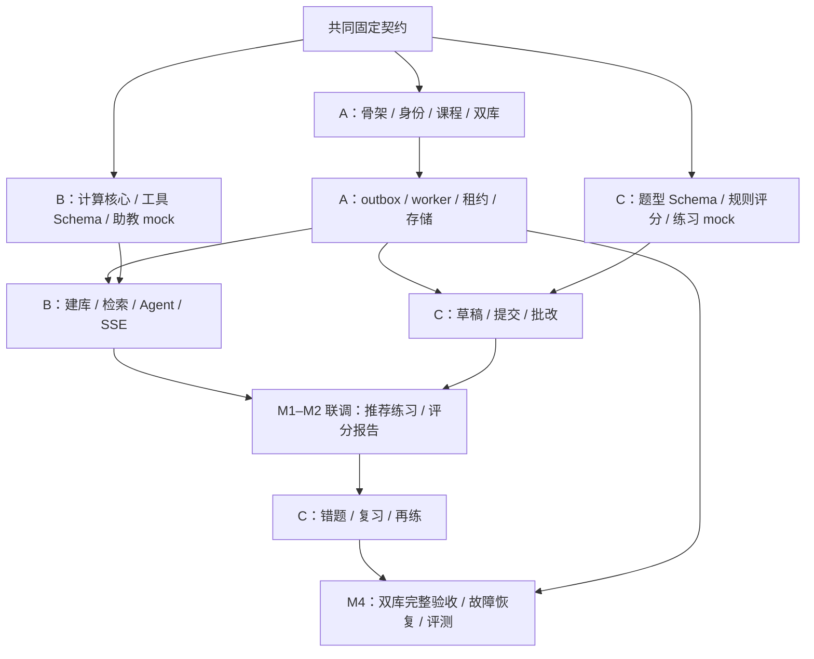

# V2 三人开发分工与交付计划

日期：2026-10-15。状态：分工建议，等待实际指派姓名；开发尚未开始。A/B/C 为三名新人，每人交付自己的后端、页面、测试与文档。负责人负责范围取舍与最终验收，关键并发/安全设计优先安排评审。

## 1. 分工和文件归属

| 人员 | 主线 | 负责目录 | 主要页面 | 完整交付边界 |
| --- | --- | --- | --- | --- |
| A | 工程底座、身份课程、可靠任务 | backend/app/modules/identity、courses；infrastructure/database、storage、jobs、observability；shared；migrations 集成；deploy/scripts/CI | 登录、课程框架、公共布局、管理任务 | 双库初始化、Cookie/CSRF、授权、UoW、Redis/MinIO、outbox/租约恢复、健康与部署 |
| B | 知识建库、检索与 Agent | modules/knowledge、tutoring；agent；infrastructure/retrieval、llm；evals 助教部分 | 来源正文、助教、引用、文档/索引管理面板 | 文件到版本化索引、工具与上下文、子网计算、run/事件、等待/恢复、模型评估 |
| C | 练习、批改与学习反馈 | modules/practice、grading、learning；evals 评分部分 | 练习、草稿、报告、错题、复习、题库管理面板 | 题目版本与审核、提交冻结、规则/rubric 评分、报告历史、复习闭环 |

A 的公共骨架负担较重：先交付最小可靠链路，B/C 同期完成纯函数、Schema、页面 mock 和领域测试。M1 后 A 重点做集成、故障恢复和运维，不继续承担 B/C 页面。B 的模型适配器同时服务 C；C 不重建第二套模型客户端。每人对自己模块的双库行为负责，A 不是所有缺陷的兜底人。

公共文件（依赖锁、app/main.py、Router 汇总、迁移 head、错误枚举）由 A 集成；其他人通过独立模块导出注册。跨模块只导入公开 service/contracts，不直接查询对方 ORM 或 Redis key。

## 2. 开始前共同固定的六个约定

1. 复核 [05](./05-API与事件契约.md) 的响应/错误/状态和写请求去重规则。
2. 确定 ActorContext/UoW/JobService/EventWriter/ObjectStorage 的项目内接口，先写小型调用样例和契约测试。
3. 固定 QuestionPublic/Evidence/RunDetail/AttemptDetail/ReportEnvelope，学生 DTO 不含答案/rubric。
4. 固定模块目录、依赖管理和迁移集成顺序；禁止独立 Alembic head 各自上线。
5. 准备共享种子标识、受控模型替身、前端 mock；不将 mock 成功当集成通过。
6. 三人将自己的第一张任务卡复述为“输入、输出、依赖、验收”，负责人确认范围后开工。

这是团队启动评审，不要求额外停工等待工具授权；本次文档补充已给出默认约定，开发发现冲突时通过 PR 提出具体修订。

## 3. 里程碑依赖

M1/M2 可重叠开发，但按闭环退出验收。工期在 M0 后按投入和实测速度估算；不承诺每位新人几天能完成复杂队列/Agent。

## 4. 第一批任务卡（可直接分配）

| 编号/主责 | 输入与任务 | 明确交付物 | 依赖 | 完成条件 |
| --- | --- | --- | --- | --- |
| A-01 | 01 配置和 08 工程约定，建立最小骨架 | pyproject/锁、API 错误/健康、Vue 布局、API client、CI 初版 | 无 | 不泄露配置；前端可调用健康；格式/lint/typecheck 通过 |
| A-02 | 04/05 身份和课程 | 双库 engine/UoW/迁移、安装身份、Cookie/CSRF、种子课程、登录/课程页 | A-01 | 两库空库升级；登录退出/CSRF/课程权限测试通过；AUTH-01/COURSE-01 |
| A-03 | 01 任务一致性与 MinIO | ObjectStorage、jobs/outbox、dispatcher/worker、角色与 job 租约、演示 handler | A-02 | 真 Redis/MinIO 演示成功；重复消息/旧租约写入被拒；不能只交接口空壳 |
| B-01 | 06 子网与工具规范 | subnet 纯函数/Schema/边界测试、Evidence/Run DTO、AgentPanel mock | 无；共享 DTO 启动评审 | /27、/28 和 /31/32 约定可验证；mock 能展示 waiting/partial/failed |
| B-02 | 04 知识模型、05 来源契约 | 领域迁移、解析分块、文档/来源页面、建库 handler | A-02 迁移、A-03 存储；可先替身开发 | md/txt/pdf 来源可定位；扫描 PDF 明确失败；KNOW-01/02 |
| C-01 | 04/05 题型和评分单位 | QuestionPublic/Admin、Answer、rubric Schema，规则评分纯函数、练习/报告 mock | 无；共享 DTO 启动评审 | 公开 Schema 不含标准；score_units 范围/汇总测试通过 |
| C-02 | 题目不可变版本和草稿 | 领域迁移、发布/选题、attempt/answers、题库/练习页面 | A-02；A 的课程和授权接口 | 固定版本；越权拒绝；草稿 CAS 冲突；PRACTICE-01/02 |

A-03 的恢复机制须由 B 或 C 评审；新人不能在未评审情况下把“消费者确认”等同为业务 exactly-once。

## 5. 后续任务卡

| 编号/主责 | 交付 | 依赖 | 验收 |
| --- | --- | --- | --- |
| B-03 | BM25/向量/RRF、manifest、发布/历史版本、中文召回测试 | B-02、A-03、embedding 替身 | 发布失败旧指针不变；同语料双库返回同契约；KNOW-01/02 |
| B-04 | 上下文/图/预算、run/job、等待续跑/取消、SSE 和页面 | B-01/03、A-03 | /27→/28 追问、无证据、partial、重连、旧租约恢复；CHAT-01–04 |
| C-03 | 正式提交与规则批改、job、报告历史、报告页 | C-02、A-03 | 重复提交和投递一个初次有效评分；提交后不能改；SUBMIT-01/GRADE-01/02 |
| C-04 | rubric 模型评分、输出校验、异常待复核、重评版本 | C-03；B 提供 ModelGateway | 异常模型得分不入库；分项/总分一致；20 份人工样本准备好 |
| B-05 + C | 安全题目/提示/学习证据工具、练习卡与报告卡 | B-04、C-03/04 | Agent 推荐能创建答卷；模型不能提交/写分；隐藏答案全链路隔离 |
| C-05 | 错题、有效学习证据、复习规则/接受/完成/再练页面 | C-03/04、B-05 | 只统计最新有效评分；重复/提示标记；LEARN-01/REVIEW-01 |
| A-04 | Compose/init/seed/版本锁定/运行手册、任务管理页 | A-03、B/C 注册 handler | 两库仅配置选择可完成全新初始化；就绪指纹一致；DB-01 |
| A-05，全员 | 故障、两库首场景、备份恢复、容量/延迟基线 | 上述闭环 | OPS-01/DB-01，实际报告含环境和 SHA，非口头“已测试” |
| B-06 + C | 助教 50 任务、人工评分 20 样本、引用/评分质量报告 | B-04、C-04 | 真实执行，披露失败；未达标则负责人缩范围 |

## 6. 必须按时交接的接口

| 提供方 → 使用方 | 提供物 | 最迟节点 | 未就绪时可做什么 |
| --- | --- | --- | --- |
| A → B/C | ActorContext、UoW、课程/身份 Schema、错误响应 | M0 前半 | 先实现纯函数、领域 Schema、页面 mock |
| A → B/C | enqueue 同事务、JobExecutionContext、ObjectStorage、测试 fixtures | M0 退出前 | 用替身验证领域逻辑，不能标记集成完成 |
| B → C | ModelGateway、结构化输出/超时/usage、subnet 计算公共函数 | M1 中段 | C 先做客观题和模型替身评分 |
| C → B | QuestionPublic、选题/提示/学习证据/提交后评分公开服务 | M2 联调前 | B 先做计算和课程问答；卡片先用 fixture |
| B/C → A | router、handler 注册、迁移 revision、种子与验证步骤 | 各阶段退出前 | A 先集成已完成链路，未交付项明确登记 |

A 提供公共测试依赖和示例，B/C 编写自己的双库用例。任何接口变更，提供方在同一 PR 更新调用方或提供兼容期，不能只发一句“字段改了”。

## 7. 各阶段退出门槛

| 里程碑 | 必须演示 | 不能算完成的情况 |
| --- | --- | --- |
| M0 | 两库初始化、登录/课程、实际 Redis/MinIO、最小可靠 job、公共前端骨架 | 只有目录、接口定义或静态页；只跑内存 SQLite |
| M1 | 真课程建库/索引、/27 咨询与 /28 追问、引用、等待/取消、刷新恢复 | 仅模型直接输出，无计算/证据校验；用 mock 假装已检索 |
| M2 | 选题、草稿、显式提交、规则/rubric 批改、历史报告、隐藏答案隔离 | 模型原文直接写成绩；重复提交生成多份首批评分 |
| M3 | 未满分项→错因/来源→接受复习→完成→新答卷 | 仅生成复习文字，没有持久计划或再练入口 |
| M4 | 两库完整首场景、故障/备份恢复、实际模型评估、运行手册 | 只勾 checklist 没有执行证据；未经测量承诺性能 |

## 8. 协作和评审

每天同步只回答已完成可验收结果、当前阻塞、需要谁提供哪个接口；阻塞写入任务卡并继续无依赖工作。集成时先走正常链路，再走 owner/隐藏答案/重复请求/故障，不用页面“能打开”代替验收。

评审轮转：A 的底座 B 主审、C 看调用可用性；B 的 Agent C 主审、A 看任务/租约；C 的评分 A 主审、B 看计算/模型安全。负责人最终检查范围和退出条件。权限、租约恢复、评分发布这些高风险 PR 如三人无法确认，应给出复现测试和具体方案交负责人评审，不凭经验猜测后合并。

任务完成定义：代码可运行、必要测试通过、接口/迁移/文档同步、相关页面状态齐全、评审完成、能用共享数据演示。进度通过 PR 和验证记录更新；本文所有任务初始状态均为“未开始”。
